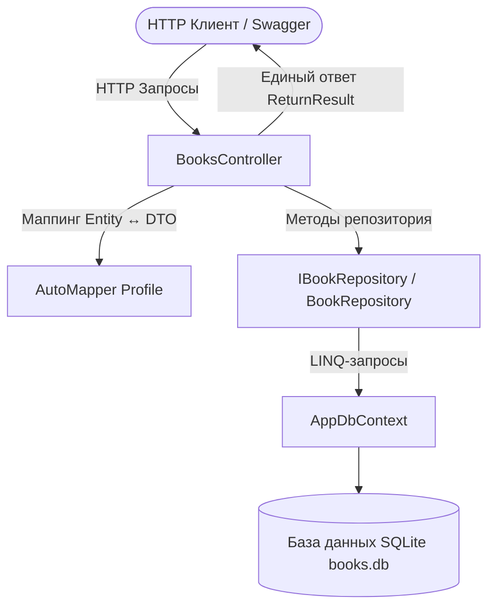

# Домашнее задание 04 (СРС): Каталог книг (Book Catalog API) с EF Core, Repository, DTO, AutoMapper и ReturnResult

## Цель работы
Разработать с нуля проект **«Каталог книг» (Book Catalog API)** на ASP.NET Core, применив современный стек разработки корпоративных сервисов:
1. **Entity Framework Core (Code First)** с автоматической инициализацией базы данных SQLite.
2. Шаблон **Repository** для сокрытия логики доступа к данным.
3. Разделение моделей на **Entity** и **DTO**.
4. Автоматическое сопоставление сущностей с помощью **AutoMapper**.
5. Единый контракт ответов API — **`ReturnResult<T>`**.
6. Полный набор CRUD-операций и дополнительный поиск книг по автору (`GET /api/books/author/{author}`).

---

## Архитектура приложения

### Схема обработки запроса
```text
Клиент / Swagger
       │ (HTTP-запрос)
       ▼
BooksController
       │
       ├──► AutoMapper (преобразование Book ◄──► BookDto)
       │
       └──► IBookRepository (BookRepository)
                   │
                   ▼
             AppDbContext (EF Core ORM)
                   │
                   ▼
             SQLite Database (books.db)
```



---

## Структура проекта

```text
Web_service_development_modul_04-hw_04/
├── .gitignore                          # Исключение временных файлов (bin/, obj/, .vs/)
├── BooksApi.slnx                       # Файл решения .NET
├── README.md                           # Полный отчет по домашнему заданию
├── DESIGN_AND_ANSWERS.md               # Архитектурный разбор и ответы на вопросы
└── src/
    └── BooksApi/
        ├── Controllers/
        │   └── BooksController.cs      # REST API Контроллер с ReturnResult
        ├── Data/
        │   └── AppDbContext.cs         # Контекст EF Core с начальным каталогом книг
        ├── Mapping/
        │   └── AutoMapperProfile.cs    # Профиль маппинга Book ↔ BookDto
        ├── Models/
        │   ├── Book.cs                 # Entity: Id, Title, Author, Year, Price, Description
        │   ├── BookDto.cs              # DTO модель книги
        │   └── ReturnResult.cs         # Единый формат ответа API
        ├── Repositories/
        │   ├── IBookRepository.cs      # Интерфейс репозитория книг
        │   └── BookRepository.cs       # Реализация доступа к данным через EF Core
        ├── Properties/
        │   └── launchSettings.json     # Профили запуска и порт 5000
        ├── appsettings.json            # Строка подключения к SQLite
        ├── Program.cs                  # Регистрация DI, EF Core, AutoMapper и Swagger
        └── BooksApi.csproj             # Файл проекта ASP.NET Core
```

---

## Спецификация Endpoints

| HTTP Method | URL | Назначение | Коды ответов |
|---|---|---|---|
| `GET` | `/api/books` | Получить каталог всех книг | `200 OK` |
| `GET` | `/api/books/{id}` | Получить книгу по ID | `200 OK`, `404 Not Found` |
| `POST` | `/api/books` | Добавить новую книгу в каталог | `201 Created`, `400 Bad Request` |
| `PUT` | `/api/books/{id}` | Изменить данные существующей книги | `200 OK`, `400 Bad Request`, `404 Not Found` |
| `DELETE` | `/api/books/{id}` | Удалить книгу по ID | `200 OK`, `404 Not Found` |
| `GET` | `/api/books/author/{author}` | **Поиск книг по автору** | `200 OK` |
| `GET` | `/swagger` | Интерактивная документация Swagger UI | `200 OK` |

---

## Модель данных `Book` / `BookDto`

```csharp
public class Book
{
    public int Id { get; set; }
    public string Title { get; set; } = string.Empty;
    public string Author { get; set; } = string.Empty;
    public int Year { get; set; }
    public decimal Price { get; set; }
    public string Description { get; set; } = string.Empty;
}
```

| Поле | Тип | Описание |
|---|---|---|
| `Id` | `int` | Уникальный числовой идентификатор книги |
| `Title` | `string` | Название книги |
| `Author` | `string` | Автор книги |
| `Year` | `int` | Год издания |
| `Price` | `decimal` | Стоимость книги в тенге (₸) |
| `Description` | `string` | Краткое описание или аннотация |

---

## Примеры ответов API (`ReturnResult<T>`)

### 1. Получение каталога книг (`GET /api/books`)
```json
{
  "isSuccess": true,
  "result": [
    {
      "id": 1,
      "title": "Чистый код",
      "author": "Роберт Мартин",
      "year": 2008,
      "price": 18500,
      "description": "Создание, анализ и рефакторинг чистого кода"
    },
    {
      "id": 2,
      "title": "Идеальный программист",
      "author": "Роберт Мартин",
      "year": 2011,
      "price": 16000,
      "description": "Руководство по профессиональной разработке ПО"
    },
    {
      "id": 3,
      "title": "Паттерны проектирования",
      "author": "Эрих Гамма",
      "year": 1994,
      "price": 22000,
      "description": "Классические объектно-ориентированные шаблоны"
    }
  ],
  "errorMessage": []
}
```

### 2. Поиск книг по автору (`GET /api/books/author/Мартин`)
```json
{
  "isSuccess": true,
  "result": [
    {
      "id": 1,
      "title": "Чистый код",
      "author": "Роберт Мартин",
      "year": 2008,
      "price": 18500,
      "description": "Создание, анализ и рефакторинг чистого кода"
    },
    {
      "id": 2,
      "title": "Идеальный программист",
      "author": "Роберт Мартин",
      "year": 2011,
      "price": 16000,
      "description": "Руководство по профессиональной разработке ПО"
    }
  ],
  "errorMessage": []
}
```

### 3. Ошибка при поиске несуществующего ID (`GET /api/books/999`) — `404 Not Found`
```json
{
  "isSuccess": false,
  "result": null,
  "errorMessage": [
    "Книга с ID 999 не найдена."
  ]
}
```

---

## Запуск приложения

```bash
# 1. Собрать проект
dotnet build

# 2. Запустить Web API
dotnet run --project src/BooksApi/BooksApi.csproj
```

* **Swagger UI:** [http://localhost:5000/swagger](http://localhost:5000/swagger)
* **Каталог книг:** [http://localhost:5000/api/books](http://localhost:5000/api/books)

---

## Инструкция по отправке в GitHub

1. Создайте пустой репозиторий на GitHub (например, `Web_service_development_modul_04-hw_04`).
2. В терминале в папке `Web_service_development_modul_04-hw_04` выполните:
   ```bash
   git remote add origin https://github.com/<ВАШ_АККАУНТ>/<ИМЯ_РЕПОЗИТОРИЯ>.git
   git push -u origin main
   ```
